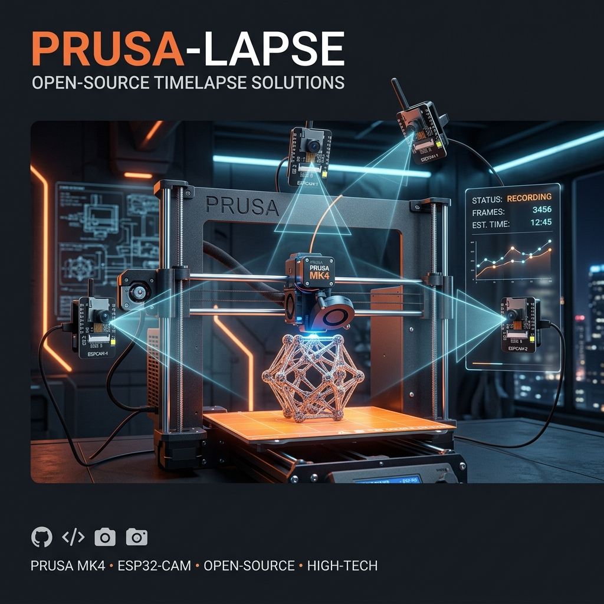

# Prusa-lapse

**An open-source hardware, firmware, and software solution for creating smooth cinematic timelapses on the Prusa MK4s using multiple ESP32-CAMs.**

## Overview

Creating a cinematic timelapse (where the print head is parked out of the way for every photo, making the object appear to "grow") can be challenging on newer printers using closed-source or cloud-based platforms. **Prusa-lapse** is a fully open-source, DIY alternative to Octolapse designed specifically to work natively with the **Prusa MK4s**, **PrusaLink**, and the **Prusa Connect Cloud API**.

It allows you to coordinate multiple **ESP32-CAM** modules over your local network. When the printer reaches a new layer, the print head is parked, and a Next.js web application triggers all cameras simultaneously to capture the moment.

## Features
*   **Multi-Camera Support:** Capture the print from multiple angles simultaneously using cheap ESP32-CAM modules.
*   **Prusa Connect Integration:** The cameras natively hook into Prusa Connect, uploading snapshots directly to the cloud dashboard without any webapp intervention.
*   **Zero-Latency Hardware Triggers:** Connect your MK4s directly to the ESP32-CAMs using Hackerboard GPIO interrupts or USB Serial (`M118`) for instantaneous, network-free capturing.
*   **Intelligent Network Polling:** Alternatively, use the `M220 S99` magic trigger for wireless polling via the PrusaLink API.
*   **Streamlined Network:** The system relies on a single lightweight shared snapshot buffer per camera instead of heavy, blocking MJPEG video streams, preserving your Wi-Fi bandwidth.
*   **Local Processing:** No cloud dependencies for the timelapse generation. Images are saved locally and compiled into an MP4 entirely on your desktop.
*   **Open Source:** MIT Licensed. Modify and adapt it to your needs!

## Project Structure

This repository is divided into five main components:

1.  **`/hardware`**: 3D printable mounts, BOM (Bill of Materials), and wiring diagrams.
2.  **`/firmware`**: C++ (PlatformIO) code for the custom ESP32-CAM firmware with HTTPS support and hardware interrupt triggers.
3.  **`/webapp`**: A beautiful Next.js web application that provides a dashboard to configure your IPs, authenticate with Prusa Connect, fetch offline sessions directly from the cameras, and compile the timelapse video.
4.  **`/cli`**: A lightweight Node.js command-line interface for generating timelapse G-code and pushing settings without running the full webapp.
5.  **`/slicer`**: Slicer configuration guides explaining how to handle extruder parking and the three different triggering methods.

## Getting Started

To build your own Prusa-lapse setup, follow the instructions in each component's directory in this order:

1.  Review the [Hardware Guide](hardware/README.md) to gather your parts, print the mounts, and wire your triggers.
2.  Follow the [Firmware Guide](firmware/README.md) to flash your ESP32-CAMs.
3.  Configure your slicer using the [Slicer Guide](slicer/README.md).
4.  **`/webapp`**: Run the Next.js web application in the [webapp directory](webapp/README.md) to manage your cameras, fetch saved offline sessions, and compile the final video.

## License

This project is licensed under the MIT License - see the [LICENSE](LICENSE) file for details.
