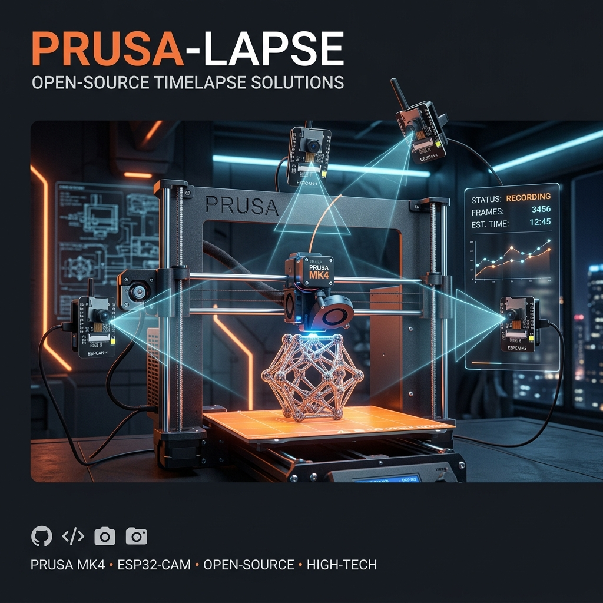

# Prusa-lapse

**An open-source hardware, firmware, and software solution for creating smooth cinematic timelapses on Prusa 3D printers using multiple ESP32-CAMs.**



## Overview

**Prusa-lapse** is an open-source, multi-camera timelapse controller designed to work natively with **Prusa MK4 / MK4s / MK3.9 / MINI / Core One / XL**, **PrusaLink**, and the **Prusa Connect Cloud API**.

When the printer finishes a layer, the toolhead parks out of view, and all **ESP32-CAM** modules capture a high-resolution UXGA frame simultaneously—saving directly to SD card and/or syncing to the desktop/server application for automated deflickered `.mp4` compilation.

## Features
* **Multi-Camera Coordination:** Capture every print from multiple angles simultaneously (e.g. Corner + X-Axis) using inexpensive ESP32-CAM modules.
* **OrcaSlicer 2.5+ Native Plugin:** Automatic G-code injection hook (`psGCodePostProcess`) with bed boundary clamping and an embedded live dashboard tab inside OrcaSlicer.
* **Preemptible Live Stream & Inert Snapshot Sharing:** Monitor any camera in real time (`~4 FPS` SVGA stream) while automatically yielding to parked UXGA timelapse captures; reuses the latest parked timelapse frame for both the dashboard and Prusa Connect.
* **Automated Deflicker & Outlier Filtering:** Built-in FFmpeg `signalstats` luminance outlier rejection and temporal deflickering (`deflicker=mode=pm:size=10`) for butter-smooth videos.
* **Wireless & Hardware Triggers:** Supports wireless PrusaLink polling (`M220 S99` + Smart Z fallback), Hackerboard GPIO interrupts (`M264`), and USB Serial UART (`M118`).

---

## Project Structure

The repository is organized around four core components:

1. **[`/webapp`](webapp/)**: Next.js web application, backend API routes, FFmpeg compilation engine (`lib/monitor.js`), 3D G-code post-processor, and automated test suite (`webapp/tests/`).
2. **[`/desktop`](desktop/)**: Native Electron desktop wrapper for Windows and Linux.
3. **[`/firmware`](firmware/)**: PlatformIO ESP32-CAM C++ firmware (`src/main.cpp`), USB flashing scripts, and [Hardware & Firmware Guide](firmware/README.md).
4. **[`/orcaslicer-plugin`](orcaslicer-plugin/)**: Pure-Python native plugin (`prusalapse/plugin.py`) and test suite for OrcaSlicer 2.5+.

*(Release packaging is automated via [`scripts/build-all-releases.js`](scripts/build-all-releases.js), outputting to `releases/`).*

---

## Getting Started

### Option A: Native Desktop App (Zero Install — Windows & Linux)
Download the pre-built desktop bundles from [`releases/`](releases/):
* **Windows (64-bit)**: Run `PrusaLapse-1.3.7-portable.exe` (zero-install portable) or `PrusaLapse-Setup-1.3.7.exe` (installer wizard).
* **Linux (x86_64)**: Extract `PrusaLapse-1.3.7-linux-x64.tar.gz` and run `./prusalapse-desktop`.

### Option B: Docker & Home Server (CasaOS, TrueNAS, Unraid, Raspberry Pi)
Run with Docker Compose:
```bash
docker compose up -d
```
Then browse to `http://<YOUR_SERVER_IP>:3000`. All timelapses (`./captures`) and settings (`./config`) persist automatically.

* **Docker CLI**:
  ```bash
  docker run -d --name prusalapse --restart unless-stopped -p 3000:3000 \
    -v /var/prusalapse/captures:/app/public/captures \
    -v /var/prusalapse/config:/app/config \
    prusalapse:latest
  ```
* **Headless Linux / Raspberry Pi (`systemd`)**:
  Extract `prusalapse-v1.3.7-server-standalone.zip` to `/opt/prusalapse`, copy the included `deploy/prusalapse.service` to `/etc/systemd/system/`, and run `sudo systemctl enable --now prusalapse`.

### Option C: Run from Source
1. Follow the [Firmware & Hardware Guide](firmware/README.md) to wire and flash your ESP32-CAMs.
2. Start the webapp in development mode:
   ```bash
   cd webapp && npm install && npm run dev
   ```

---

## Slicer Setup

### 1. OrcaSlicer 2.5+ Native Plugin (Recommended)
1. Open the PrusaLapse Dashboard and navigate to **Slicer Integration -> OrcaSlicer**.
2. Click **Install Plugin into OrcaSlicer** and restart OrcaSlicer (or manually extract `prusalapse-orcaslicer-plugin.zip` into `%APPDATA%\OrcaSlicer\orca_plugins\` on Windows, `~/Library/Application Support/OrcaSlicer/orca_plugins/` on macOS, or `~/.config/OrcaSlicer/orca_plugins/` on Linux).
3. Enable **Auto-Inject OrcaSlicer** in the Slicer panel to automatically inject toolhead parking and `M220 S99` triggers on every slice.

### 2. Built-in Web G-Code Post-Processor (PrusaSlicer / Any Slicer)
Drag and drop any ASCII `.gcode` file into the **Slicer Integration** panel in the PrusaLapse UI to preview the 3D toolpath and download the trigger-injected G-code in one click.

### 3. PrusaSlicer Custom After-Layer G-Code Snippet
To inject triggers automatically inside PrusaSlicer (`Printer Settings -> Custom G-code -> After layer change G-code`), paste the snippet generated in the **Slicer Integration** panel of the web UI:
```gcode
; --- PRUSA-LAPSE PARKED TIMELAPSE START ---
{if layer_num > 1}
M83 ; relative extrusion
G1 E-1.2 F2400 ; retract
G91 ; relative positioning
G1 Z0.4 F7200 ; Z-hop
G90 ; absolute positioning
G1 X240 Y210 F9000 ; park toolhead at back-right corner
M400 ; wait for moves to finish
G4 P300 ; settle vibrations
M220 S99 ; trigger ESP32-CAM capture
G4 P1200 ; wait for capture
M220 S100 ; restore speed factor
G1 E1.2 F2400 ; unretract
{endif}
; --- PRUSA-LAPSE PARKED TIMELAPSE END ---
```

## License

This project is licensed under the MIT License - see the [LICENSE](LICENSE) file for details.
