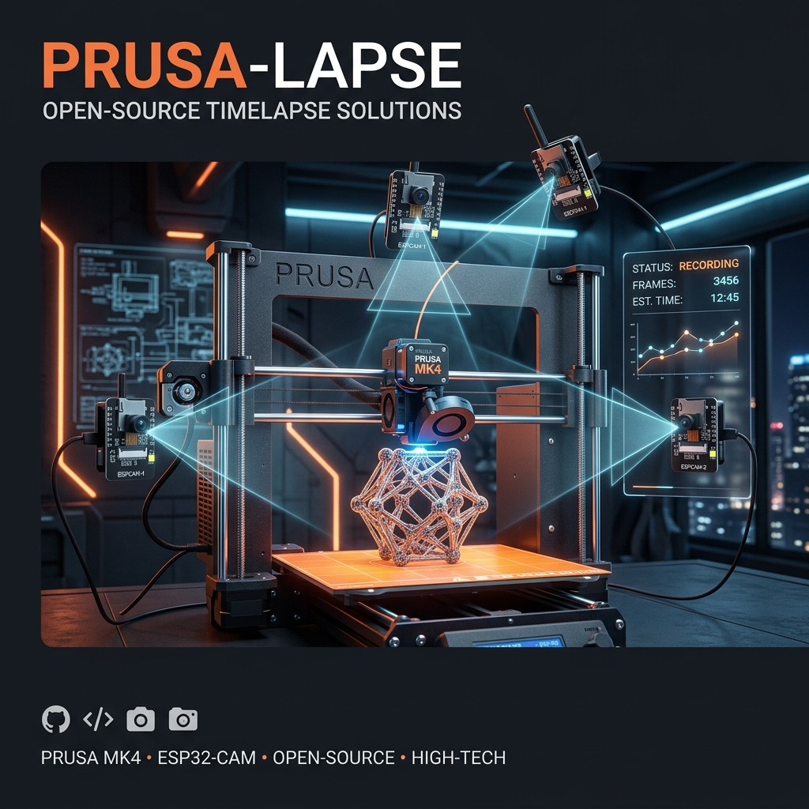

# Prusa-lapse

**An open-source hardware, firmware, and software solution for creating smooth cinematic timelapses on the Prusa MK4s using multiple ESP32-CAMs.**



## Overview

Creating a cinematic timelapse (where the print head is parked out of the way for every photo, making the object appear to "grow") can be challenging on newer printers using closed-source or cloud-based platforms. **Prusa-lapse** is a fully open-source, DIY alternative to Octolapse designed specifically to work natively with the **Prusa MK4s**, **PrusaLink**, and the **Prusa Connect Cloud API**.

It allows you to coordinate multiple **ESP32-CAM** modules over your local network. When the printer reaches a new layer, the print head is parked, and a Next.js web application triggers all cameras simultaneously to capture the moment.

## Features
*   **Multi-Camera Support:** Capture the print from multiple angles simultaneously using cheap ESP32-CAM modules.
*   **OrcaSlicer 2.5+ Native Plugin:** Automatic G-code injection hook (`psGCodePostProcess`) and embedded live dashboard tab directly in OrcaSlicer with 1-click installation.
*   **Prusa Connect Integration:** The cameras natively hook into Prusa Connect, uploading snapshots directly to the cloud dashboard without any webapp intervention.
*   **Zero-Latency Hardware Triggers:** Connect your MK4s directly to the ESP32-CAMs using Hackerboard GPIO interrupts or USB Serial (`M118`) for instantaneous, network-free capturing.
*   **Intelligent Network Polling:** Alternatively, use the `M220 S99` magic trigger for wireless polling via the PrusaLink API.
*   **Streamlined Network:** The system relies on a single lightweight shared snapshot buffer per camera instead of heavy, blocking MJPEG video streams, preserving your Wi-Fi bandwidth.
*   **Local Processing:** No cloud dependencies for the timelapse generation. Images are saved locally and compiled into an MP4 entirely on your desktop.
*   **Open Source:** MIT Licensed. Modify and adapt it to your needs!

## Project Structure

This repository is divided into six main components:

1.  **`/hardware`**: 3D printable mounts, BOM (Bill of Materials), and wiring diagrams.
2.  **`/firmware`**: C++ (PlatformIO) code for the custom ESP32-CAM firmware with HTTPS support and hardware interrupt triggers.
3.  **`/webapp`**: A beautiful Next.js web application that provides a dashboard to configure your IPs, authenticate with Prusa Connect, fetch offline sessions directly from the cameras, and compile the timelapse video.
4.  **`/cli`**: A lightweight Node.js command-line interface for generating timelapse G-code and pushing settings without running the full webapp.
5.  **`/slicer`**: Slicer configuration guides explaining how to handle extruder parking and the three different triggering methods.
6.  **`/orcaslicer-plugin`**: Native Python plugin for OrcaSlicer 2.5+ with dynamic bed boundary clamping, automated toolhead parking injection, and embedded web UI.

## Getting Started

### Option A: Portable Desktop App (Zero Install — Windows & Linux)
Download the pre-built desktop bundles from the latest [Release](releases/):
* **Windows (64-bit)**: Download `PrusaLapse-1.3.0-portable.exe` (zero-install portable) or `PrusaLapse-Setup-1.3.0.exe` (installer wizard). No Node.js or setup required!
* **Linux (x86_64)**: Extract `PrusaLapse-1.3.0-linux-x64.tar.gz` and run `./prusalapse-desktop`. Works out-of-the-box on Ubuntu, Debian, Fedora, Arch, etc.

### Option B: Home Server / Docker Deployment (CasaOS, TrueNAS, Unraid)
Run anywhere with Docker Compose:
```bash
docker compose up -d
```
All timelapses (`./captures`) and settings (`./config`) persist automatically. See the [Docker Deployment Guide](deploy/DOCKER_DEPLOYMENT.md) for CasaOS, Unraid, TrueNAS, and systemd instructions.

### Option C: Developer Setup
1. Review the [Hardware Guide](hardware/README.md) to gather your parts and wire your triggers.
2. Follow the [Firmware Guide](deploy/firmware/README.md) to flash your ESP32-CAMs.
3. Configure your slicer using the [Slicer Setup](#slicer-setup) instructions below or the [Slicer Guide](slicer/README.md).
4. Run the webapp from source:
   ```bash
   cd webapp && npm install && npm run dev
   ```

## Slicer Setup

### OrcaSlicer 2.5+ Native Plugin

PrusaLapse includes a native Python plugin for **OrcaSlicer 2.5+** that automatically injects toolhead parking moves, settling delays, and camera capture triggers (`M220 S99`) during slicing, while embedding the live PrusaLapse dashboard directly inside OrcaSlicer.

#### Option 1: 1-Click Install from Dashboard (Recommended)
1. Open the PrusaLapse Web Interface or Desktop App.
2. Navigate to **Slicer Setup** -> **OrcaSlicer Native Plugin (v2.5+)**.
3. If OrcaSlicer is detected on your system, click **Install Plugin into OrcaSlicer**.
4. Restart OrcaSlicer. A new **PrusaLapse** tab will appear in the top navigation bar with live camera feeds and status.
5. In the PrusaLapse Slicer panel, enable **Auto-Inject OrcaSlicer** to automatically inject parking G-code on slice.

#### Option 2: Manual `.zip` Installation
1. Download `prusalapse-orcaslicer-plugin.zip` from the latest [Release](releases/v1.3.0/).
2. Extract the archive directly into OrcaSlicer's `plugins` folder for your operating system:
   - **Windows**:
     ```powershell
     %APPDATA%\OrcaSlicer\plugins\
     ```
     *(extracting creates `%APPDATA%\OrcaSlicer\plugins\prusalapse\`)*
   - **macOS**:
     ```bash
     ~/Library/Application Support/OrcaSlicer/plugins/
     ```
     *(creates `~/Library/Application Support/OrcaSlicer/plugins/prusalapse/`)*
   - **Linux**:
     ```bash
     ~/.config/OrcaSlicer/plugins/
     ```
     *(creates `~/.config/OrcaSlicer/plugins/prusalapse/`)*
3. Restart OrcaSlicer.

> [!TIP]
> **Safety Guardrails**: The plugin automatically detects bed boundaries and clamps parking coordinates safely for Prusa MK4, MK3.9, MINI, and XL. It enforces relative extrusion (`M83`) safety checks, uses fallback coordinates if the PrusaLapse server is offline, and skips binary `.bgcode` files automatically.

### PrusaSlicer Setup
For PrusaSlicer, use the built-in G-Code Post-Processor in the web interface or copy the custom after-layer snippet from [`slicer/README.md`](slicer/README.md).

## License

This project is licensed under the MIT License - see the [LICENSE](LICENSE) file for details.
