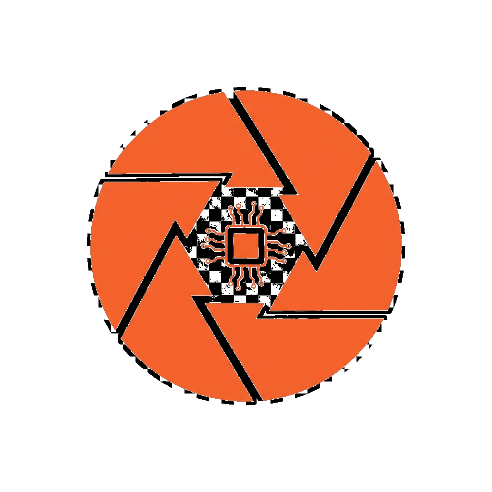

# Prusa-lapse Brand Identity & Style Guide

This document defines the visual identity of the Prusa-lapse project. All interfaces, documentation graphics, and community materials should adhere to these guidelines.

---

## Logo

The Prusa-lapse logo combines a **camera shutter/aperture** with **timelapse motion trails** and subtle **circuit elements**, representing the fusion of cinematic photography, 3D printing, and ESP32 hardware.



### Usage Rules
*   Always display the logo on a dark background (`#0B0E13` or darker).
*   Maintain a minimum clear space around the logo equal to the height of the aperture icon.
*   Do not stretch, skew, recolor, or add effects to the logo.

---

## Color Palette

The palette is inspired by **Prusa Research's** iconic orange-and-black identity, extended with supporting tones for a premium dark UI.

### Primary Colors

| Swatch | Name | HEX | RGB | Usage |
|--------|------|-----|-----|-------|
| 🟠 | **Prusa Orange** | `#FA6831` | `250, 104, 49` | Primary accent, CTAs, active states |
| ⚫ | **Deep Black** | `#0B0E13` | `11, 14, 19` | App background, primary surfaces |

### Secondary Colors

| Swatch | Name | HEX | RGB | Usage |
|--------|------|-----|-----|-------|
| 🟠 | **Warm Amber** | `#FF8C42` | `255, 140, 66` | Hover states, gradients, highlights |
| 🔴 | **Sunset Red** | `#E8533F` | `232, 83, 63` | Error states, stop/danger actions |
| 🟢 | **Status Green** | `#34D399` | `52, 211, 153` | Success, online indicators |
| 🔵 | **Info Blue** | `#60A5FA` | `96, 165, 250` | Informational text, links |

### Neutral Colors

| Swatch | Name | HEX | Usage |
|--------|------|-----|-------|
| ⬜ | **Text Primary** | `#E6EDF3` | Headings, primary copy |
| ⬜ | **Text Secondary** | `#8B949E` | Labels, descriptions, timestamps |
| ⬛ | **Surface** | `#161B22` | Cards, panels (with transparency) |
| ⬛ | **Border** | `rgba(255,255,255,0.08)` | Dividers, input borders |

### Gradients

*   **Orange Glow**: `linear-gradient(135deg, #FA6831, #FF8C42)` — Used for primary buttons and accent highlights.
*   **Background Radial**: Subtle radial gradients using `#FA6831` at 6% opacity to add warmth to the dark background.

---

## Typography

| Role | Font | Weight | Size | Fallback |
|------|------|--------|------|----------|
| **Headings** | Inter | 700 (Bold) | 2rem–2.5rem | system-ui, sans-serif |
| **Body** | Inter | 400 (Regular) | 0.95rem–1rem | system-ui, sans-serif |
| **Labels** | Inter | 500 (Medium) | 0.85rem | system-ui, sans-serif |
| **Monospace** (logs, IPs) | JetBrains Mono | 400 | 0.85rem | monospace |

Import via Google Fonts:
```html
<link href="https://fonts.googleapis.com/css2?family=Inter:wght@400;500;600;700&family=JetBrains+Mono:wght@400;500&display=swap" rel="stylesheet">
```

---

## Spacing & Layout

| Token | Value | Usage |
|-------|-------|-------|
| `--space-xs` | `4px` | Tight internal padding |
| `--space-sm` | `8px` | Badge padding, small gaps |
| `--space-md` | `16px` | Input padding, card gaps |
| `--space-lg` | `24px` | Panel padding |
| `--space-xl` | `40px` | Section spacing |
| `--radius-sm` | `6px` | Badges, small chips |
| `--radius-md` | `10px` | Inputs, buttons |
| `--radius-lg` | `16px` | Cards, panels |
| `--radius-xl` | `20px` | Main container |

---

## Component Styles

### Buttons

*   **Primary (CTA):** Orange gradient background, dark text, glowing box-shadow (`0 0 20px rgba(250,104,49,0.4)`). Scales to 1.02 on hover.
*   **Danger:** Solid `#E8533F`, white text, used for "Stop" actions.
*   **Ghost:** Transparent background, subtle border, white text. Used for secondary actions like "Save Configuration".

### Cards / Panels

*   Background: `rgba(22, 27, 34, 0.5)` with `backdrop-filter: blur(16px)`.
*   Border: `1px solid rgba(255, 255, 255, 0.06)`.
*   Hover: Subtle `translateY(-3px)` lift with increased box-shadow.

### Inputs

*   Background: `rgba(0, 0, 0, 0.4)`.
*   Border: `1px solid rgba(255, 255, 255, 0.08)`.
*   Focus: Border transitions to `#FA6831` with a `0 0 0 3px rgba(250,104,49,0.25)` ring.

### Status Badges

*   **Online/Active**: Green text `#34D399`, green-tinted background with green border.
*   **Offline/Inactive**: Red text `#E8533F`, red-tinted background with red border.

---

## Animations & Motion

| Animation | Duration | Easing | Usage |
|-----------|----------|--------|-------|
| Page entrance (slide up + fade) | 600ms | `cubic-bezier(0.16, 1, 0.3, 1)` | Dashboard container on load |
| Panel entrance (staggered) | 500ms | `cubic-bezier(0.16, 1, 0.3, 1)` | Each panel delays by 100ms |
| Recording pulse | 1.5s infinite | ease-in-out | Red dot when monitoring is active |
| Hover lift | 300ms | ease | Cards, buttons |
| Focus ring | 200ms | ease | Input focus states |
| Log entry fade-in | 300ms | ease-out | New log entries appearing |

---

## Iconography

Use simple, clean icons that match the monoline style. Recommended sources:
*   [Lucide Icons](https://lucide.dev/) (open source, consistent style)
*   Inline SVGs preferred over icon fonts for performance.

---

## Tone of Voice

*   **Technical but friendly.** We're speaking to makers and tinkerers.
*   **Concise.** Labels and messages should be short and scannable.
*   **Encouraging.** Success messages should feel rewarding ("Camera captured successfully ✓").
